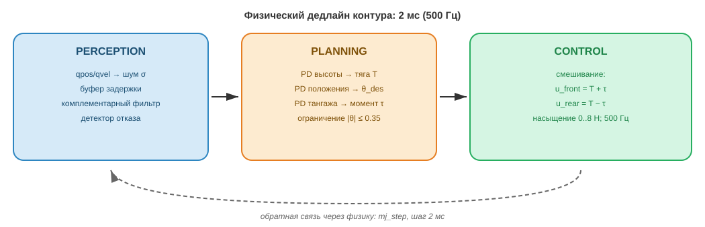
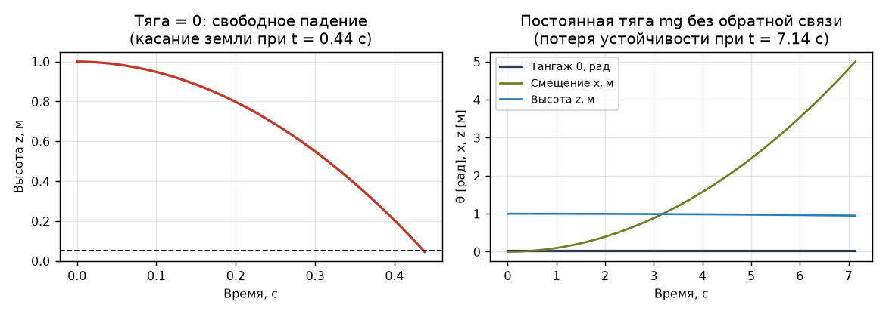
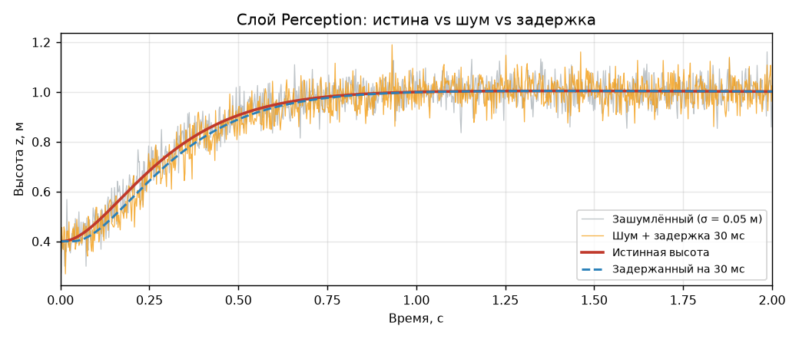
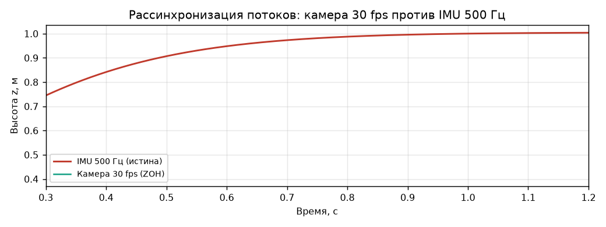
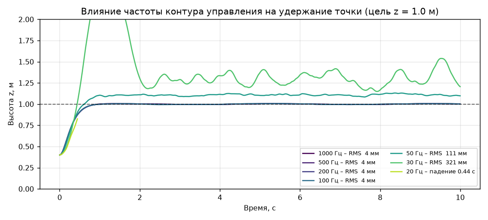
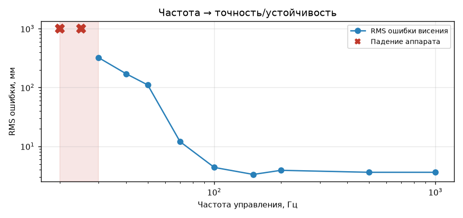
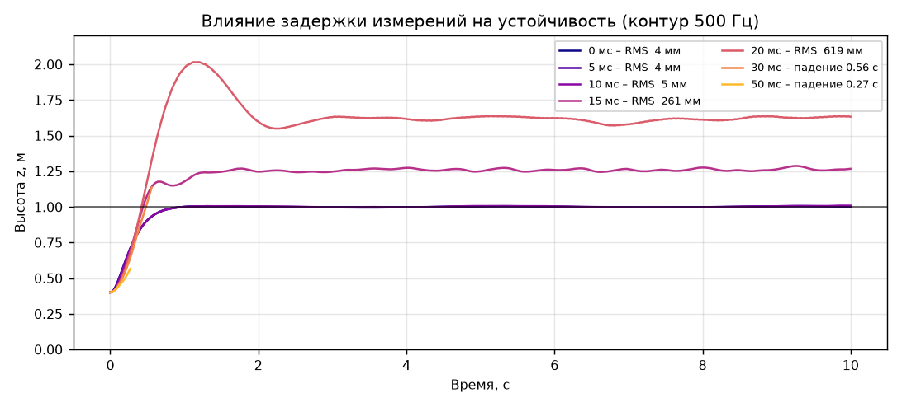
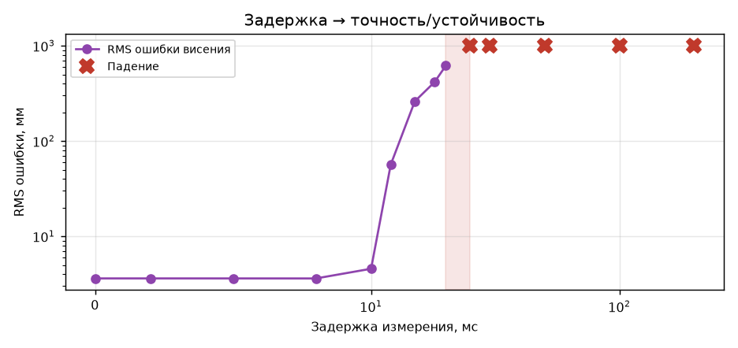
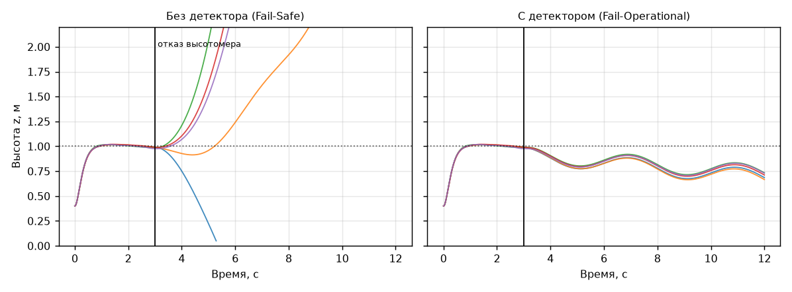
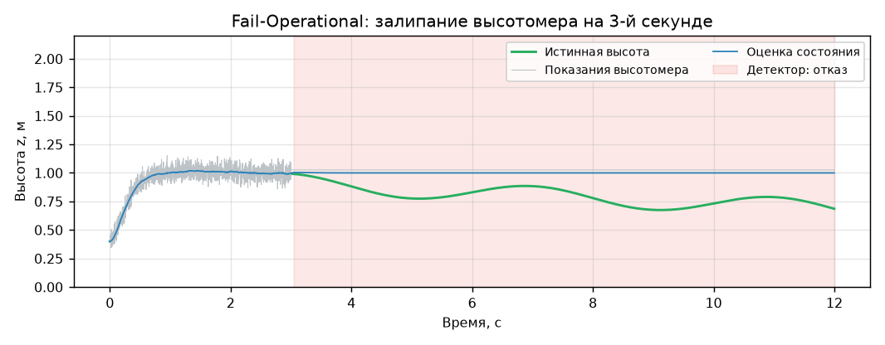

# Лабораторная работа №1 — Physical AI

**Тема:** «Первый контакт с физикой: настройка симуляции, слои Perception → Planning → Control и физический дедлайн» 

---
**Вариант 10.** Объект: 2D-квадрокоптер; задача: висение в точке; особенность: PD по высоте.   

**IDE:** PyCharm Community Edition.   

**Цель работы:** закрепить три фундаментальных тезиса лекции №1 через практику:   
* Физический дедлайн вместо бизнес-логического – почувствовать разницу между задержкой 200 мс (веб) и 5–20 мс (робот).   
* Необратимость ошибки – увидеть, что падение в симуляции нельзя «откатить» без перезапуска эпизода.   
* Отсутствие изоляции от среды – познакомиться с шумными, неполными и непрерывно меняющимися входными данными.   
**Дополнительно:** разобрать архитектуру «три слоя» (Perception → Planning → Control) на конкретной реализации.

**Задачи работы:**   
* Развернуть среду симуляции MuJoCo и запустить базовую модель без контроллера.
* Реализовать слой Perception: извлечение состояния из симуляции, добавление шума и задержки.
* Реализовать слой Planning: каскадный PD – внутренний контур тангажа, внешний контур положения.
* Реализовать слой Control: контур управления с фиксированной частотой и эксперименты по частоте и задержке.
* Собрать полный замкнутый контур и реализовать принцип Fail-Operational (детектор отказа сенсора).
* Оформить отчёт с графиками, таблицами и ответами на контрольные вопросы.
  
---
## Описание модели:

В качестве объекта управления рассматривается плоский (2D) квадрокоптер – продольная проекция мультикоптера, включающая раму с двумя роторами (передним и задним), способную перемещаться в плоскости XZ и наклоняться вокруг оси Y.    

Модель обладает тремя степенями свободы:
* поступательное перемещение по горизонтальной оси x;
* поступательное перемещение по вертикальной оси z;
* вращательное движение (тангаж) θ относительно оси Y.
  
Управляющими воздействиями являются тяги двух роторов f_L и f_R, направленные вдоль связанной оси Z корпуса. При наклоне корпуса на угол θ вектор тяги поворачивается вместе с ним, что приводит к перераспределению тяги между вертикальной и горизонтальной составляющими. Именно этот механизм обеспечивает поступательное движение аппарата.
 

Распределение ответственности между слоями:

**Слой Perception** осуществляет чтение состояния из симуляции (data.qpos, data.qvel), вносит аддитивный гауссов шум, пропускает измерения через буфер транспортной задержки DelayedSensor, выполняет комплексирование измерений с прогнозом по модели посредством комплементарного фильтра и запускает детектор отказа. Результатом работы слоя является оценка состояния s ̂=(x ̂,z ̂,θ ̂,v ̂_x,v ̂_z,ω ̂ ).
	
**Слой Planning** реализует каскадный PD-регулятор. Внешний контур по высоте формирует требуемое ускорение a_z и суммарную тягу T; внешний контур по горизонтали формирует требуемое ускорение a_x, которое пересчитывается в задание по тангажу θ^*=clip(a_x/g, ±0.35). Таким образом, «план» представляет собой не траекторию, заданную заранее, а уставку, пересчитываемую на каждом такте управления.

**Слой Control** реализует внутренний контур тангажа (PD по θ и ω), формирующий момент τ и микшер, распределяющий T и τ по роторам: f_(L,R)=T/2±τ/(2l). На управляющие воздействия накладывается ограничение 0 ≤ f ≤ 8 Н. Команда записывается в data.ctrl и удерживается до следующего такта контура (режим zero-order hold). Коэффициенты регуляторов: K_(p,z)=40, K_(d,z)=12; K_(p,x)=2.0, K_(d,x)=2.4; K_(p,θ)=4900, K_(d,θ)=140 (собственная частота контура тангажа ω_n≈70 рад/с, ζ≈1). Такие значения типичны для реального мультикоптера и именно они задают физический дедлайн контура.

---

## Эксперимент 1. Baseline: система без контроллера

Проведены два опыта: (а) тяга роторов равна нулю; (б) тяга постоянна и в точности равна весу (f_L = f_R = mg/2), обратная связь отсутствует; начальный крен 0.02 рад (≈1.1°).

### Таблица 1 – Поведение аппарата без обратной связи

| Опыт | Время до срыва | Причина срыва |
|---|---|---|
| Тяга = 0, свободное падение с 1 м | 0.44 с | касание земли |
| Тяга = mg/2, крен 0.02 рад, без обратной связи | 7.14 с | уход по горизонтали, \|x\|>5 м |

### Выводы по эксперименту 1

Полный бюджет времени системы составляет 0.44 с, что меньше типичного таймаута HTTP-запроса. При шаге физики 2 мс это соответствует 220 тактам.

Опыт (б) демонстрирует отсутствие изоляции от среды: тяга подобрана строго равной весу, вертикальный канал практически идеален (отклонение высоты от 1.000 до 0.95 м обусловлено только неучтённым возмущением), однако начальное отклонение угла на 1.1°, не измеряемое и не компенсируемое системой, приводит к смещению аппарата на 5 м за 7 с. Таким образом, разомкнутая система не «падает с ошибкой», а постепенно выходит из рабочей зоны, что не сопровождается никакими программными исключениями.

Выбор шага физики 2 мс (500 Гц) не является произвольным и обосновывается в ответе на контрольный вопрос №1.

---

## Слой Perception: шум, задержка, рассинхронизация

Смоделированы три эффекта реального сенсорного тракта: аддитивный гауссов шум (σ = 0.05 м по положению), транспортная задержка 30 мс (буфер `deque`) и разная частота источников данных.

Шум и задержка искажают сигнал принципиально различным образом. Шум представляет собой ошибку с нулевым средним, которая может быть отфильтрована за счёт снижения полосы пропускания. Задержка не смещает среднее, но вносит фазовый сдвиг: на участке интенсивного набора высоты (0.3–0.8 с) задержанный сигнал отстаёт от истинного на 30 мс, что соответствует ошибке по высоте до 0.15 м. Принципиально важно, что информация о текущем состоянии в сигнале отсутствует, и никакая фильтрация не способна её восстановить.

Медленный канал (30 fps) формирует ступенчатую картину мира (zero-order hold), а возраст данных пилообразно изменяется в диапазоне от 0 до 33 мс.

---

## Эксперимент 2. Частота контура управления → устойчивость

Частота физики зафиксирована на 500 Гц, частота контура управления варьируется. При частоте контура ниже частоты физики команда удерживается постоянной (zero-order hold) на нескольких шагах интегрирования, как в реальной системе между тактами планировщика.

### Таблица 2 – Влияние частоты управления

| Частота управления | Период такта | Время до падения | RMS ошибки висения | Устойчиво? | Комментарий |
|---|---|---|---|---|---|
| 1000 Гц | 1.0 мс | не упал (10 с) | 3.6 мм | Да | Уровень Atlas: запас по фазе максимальный |
| 500 Гц | 2.0 мс | не упал (10 с) | 3.6 мм | Да | Уровень Unitree; совпадает с 1000 Гц — контур уже не является узким местом |
| 200 Гц | 5.0 мс | не упал (10 с) | 3.9 мм | Да | «Веб-нормально»: деградация ещё не видна |
| 150 Гц | 6.7 мс | не упал (10 с) | 3.3 мм | Да | Запас сохраняется |
| 100 Гц | 10 мс | не упал (10 с) | 4.4 мм | Да | Нижняя граница «рабочей» зоны |
| 70 Гц | 14 мс | не упал (10 с) | 12.0 мм | Да, с деградацией | Ошибка выросла втрое, появилась рябь по тангажу |
| 50 Гц | 20 мс | не упал (10 с) | 111 мм | На границе | Автоколебания ±0.1 м, задача висения фактически не выполняется |
| 40 Гц | 25 мс | не упал (10 с) | 171 мм | Нет | Колебания нарастают, точка висения «плывёт» |
| 30 Гц | 33 мс | не упал (10 с) | 304 мм | Нет | Заброс до 2.4 м, аппарат удерживается случайно |
| 25 Гц | 40 мс | 2.72 с | — | Нет | Опрокидывание \|θ\|>90° |
| 20 Гц | 50 мс | 0.44 с | — | Нет | Опрокидывание почти мгновенно |

Критическая частота лежит в диапазоне 25–30 Гц. Однако практическая граница выше: качество висения начинает разрушаться ниже 70 Гц, а рабочей зоной следует считать частоты не ниже 100 Гц.

Падение всегда происходит по каналу тангажа, а не по высоте. При частоте 20 Гц аппарат опрокидывается на высоте 0.85 м, не достигнув земли. Медленный контур не успевает парировать вращение, возбуждённое предыдущей командой, что представляет собой классическую потерю устойчивости вследствие дискретизации.

В диапазоне 1000–100 Гц различие в точности несущественно (3–4 мм). Следовательно, повышение частоты сверх необходимой не даёт выигрыша, тогда как снижение ниже дедлайна недопустимо. Зависимость носит пороговый, а не плавный характер.

---

## Эксперимент 3. Задержка измерений → устойчивость

Частота контура зафиксирована на 500 Гц, в канал измерения введена транспортная задержка от 0 до 200 мс.

### Таблица 3 – Влияние задержки измерения

| Задержка | Время до падения | RMS ошибки висения | Устойчиво? | Комментарий |
|---|---|---|---|---|
| 0 мс | не упал (10 с) | 3.6 мм | Да | Идеальный (нереализуемый) случай |
| 2 мс | не упал (10 с) | 3.6 мм | Да | Один такт физики — незаметно |
| 5 мс | не упал (10 с) | 3.6 мм | Да | Уровень хорошего бортового IMU-тракта |
| 8 мс | не упал (10 с) | 3.6 мм | Да | Запас по фазе ещё достаточен |
| 10 мс | не упал (10 с) | 4.6 мм | Да | Начало деградации |
| 12 мс | не упал (10 с) | 57 мм | Да, с деградацией | Ошибка выросла в 12 раз за 2 мс задержки |
| 15 мс | не упал (10 с) | 261 мм | Нет | Устойчивый заброс, висение на 1.27 м вместо 1.0 м |
| 18 мс | не упал (10 с) | 415 мм | Нет | Точка висения смещена на 0.4 м |
| 20 мс | не упал (10 с) | 619 мм | Нет | Заброс до 2.0 м, висение на 1.62 м — задача не выполняется |
| 25 мс | 1.32 с | — | Нет | Опрокидывание |
| 30 мс | 0.56 с | — | Нет | Опрокидывание |
| 50 мс | 0.27 с | — | Нет | Опрокидывание |
| 100 мс | 0.11 с | — | Нет | Первая же команда подаётся «вслепую» |
| 200 мс | 0.11 с | — | Нет | Типовая веб-задержка — аппарат не взлетает вовсе |

Граница устойчивости по задержке – 20…25 мс. До 10 мс система функционирует штатно; в диапазоне 12…20 мс формально сохраняет устойчивость, но перестаёт решать задачу (ошибка висения от 6 до 62 см); при 25 мс и выше – опрокидывается.

Полученный результат согласуется с теоретической оценкой: запас по фазе контура тангажа при ω_n ≈ 70 рад/с даёт допустимое запаздывание порядка 1/ω_n ≈ 14 мс, что соответствует экспериментально наблюдаемому диапазону.

Особое внимание следует уделить строке «200 мс». Указанная задержка является стандартной и приемлемой для веб-приложений. Для рассматриваемого аппарата она означает падение через 0.11 с, то есть система не успевает выполнить ни одной осмысленной команды. Таким образом, одно и то же численное значение в различных предметных областях интерпретируется противоположным образом.

---

## Эксперимент 4. Интеграция слоёв и Fail-Operational

Собран полный замкнутый контур `DelayedSensor → комплементарный фильтр → Planning → ControlLoop` при 500 Гц, задержке 4 мс и штатном шуме σ = 0.05. На третьей секунде имитируется отказ высотомера типа «залипание»: датчик прекращает обновление и повторяет последнее значение. Данный тип отказа характерен для лидаров и барометров и представляет особую опасность, поскольку сигнал сохраняет правдоподобный вид и не содержит очевидных признаков аварии.

Детектор функционирует на основе анализа скользящей дисперсии сигнала высоты за последние N = 25 тактов:

- дисперсия выше порога 0.02 м² соответствует отказу типа «зашумление», доверие к датчику снижается вдвое;
- дисперсия ниже порога 3·10⁻⁴ м² соответствует отказу типа «залипание», поскольку исправный датчик всегда обладает собственным шумом; датчик исключается из оценки, система переходит на предсказание по модели;
- отказ «защёлкивается»: возврат к датчику возможен только после целого окна корректных измерений.

### Таблица 4 – Сравнение режимов (5 запусков, отказ «залипание» на 3-й с)

| Режим | Время до падения | Качество висения | Комментарий |
|---|---|---|---|
| Без детектора отказа | 5.29 / 7.02 / 7.98 / 8.45 с; 1 запуск из 5 уцелел | RMS 2.26 м у уцелевшего | Fail-Safe: система падает. Причины срыва разные — в одном запуске касание земли, в трёх — неуправляемый набор высоты z>6 м. Формально «выживший» запуск висит с ошибкой 2.3 м, то есть задача тоже провалена |
| С детектором отказа | не упал ни разу (12 с) | RMS 0.24...0.29 м | Fail-Operational: после срабатывания детектора аппарат переходит на предсказание по модели, точность падает примерно в 30 раз, но полёт продолжается и остаётся управляемым |

### Таблица 5 – Контрольные режимы без отказа датчика

| Режим | Время до падения | RMS ошибки | Комментарий |
|---|---|---|---|
| Штатный шум σ=0.1, без детектора | не упал | 16.9 мм | Комплементарный фильтр сам справляется с шумом такого уровня |
| Штатный шум σ=0.1, с детектором | не упал | 16.8 мм | Детектор не срабатывает — ложных тревог нет |
| Всплеск шума до σ=0.5, без детектора | не упал | 0.32 м | Точность разрушена, но фильтр удерживает аппарат |
| Всплеск шума до σ=0.5, с детектором | не упал | 0.34 м | Детектор срабатывает корректно, но выигрыша не даёт |

Принцип Fail-Operational подтверждён экспериментально: без детектора система падает в 4 запусках из 5, с детектором – не падает ни разу.

Детектор эффективен только против отказа типа «залипание». В условиях чистого зашумления его применение не даёт выигрыша, поскольку фильтр и без того усредняет шум с нулевым средним, а снижение доверия к датчику лишь увеличивает запаздывание. Это соответствует инженерной практике: шум является штатным режимом работы, тогда как отказ представляет собой потерю информации, и методы борьбы с ними различны.

Ограничение решения: предсказание по модели представляет собой резерв конечного горизонта. Поскольку вертикальный канал квадрокоптера неустойчив, расхождение оценки и реальности накапливается: за 9 с работы в режиме предсказания аппарат опустился с 1.0 до 0.7–0.9 м. Полноценная Fail-Operational-система использовала бы этот временной запас для перехода на резервный датчик или выполнения аварийной посадки.

---

## Контрольные вопросы

### 1. Почему частота физики в MuJoCo – 500 Гц, а не 60 Гц, как частота монитора?

Частота монитора определяется физиологией восприятия: 60 Гц достаточно для отсутствия видимого мерцания. Данная величина относится к бизнес-дедлайну и характеризует взаимодействие с пользователем.

Частота интегрирования определяется динамикой объекта и требованием численной устойчивости: шаг интегрирования должен быть существенно меньше наименьшей постоянной времени системы. В рассматриваемой модели наиболее быстрым звеном является контур тангажа с собственной частотой порядка 70 рад/с. При шаге 1/60 с (16.7 мс) на период собственных колебаний приходилось бы около 5 точек, что привело бы к расходимости явной схемы интегрирования. Шаг 2 мс обеспечивает около 45 точек на период, что гарантирует устойчивость численного решения.

Приведённые рассуждения согласуются с положением лекции о дедлайне 1–2 мс: частота обновления контура Atlas обусловлена не вычислительной мощностью, а динамикой тела. Пропуск кадра видеопотока не приводит к негативным последствиям; пропуск такта управления, как показал эксперимент 3, приводит к опрокидыванию за 0.44 с.

### 2. Как проявляется рассинхронизация потоков данных (камера 30 fps, IMU 1000 Гц) на вашем графике «истина vs зашумлённый vs задержанный»?

Зашумлённый сигнал колеблется относительно истинного значения, однако не отстаёт от него: его среднее совпадает с истиной, и ошибка может быть усреднена. Задержанный сигнал, напротив, является гладким, но сдвинутым по времени: на участке интенсивного набора высоты (0.3–0.8 с) он отображает состояние 30 мс назад, что соответствует расхождению до 0.15 м.

Рассинхронизация потоков данных приводит к тому, что медленный канал (30 fps) формирует ступенчатую картину мира (zero-order hold), а возраст данных пилообразно изменяется в диапазоне от 0 до 33 мс. Для системы управления это означает, что два источника описывают различные моменты времени одного объекта, и их наивное объединение в едином регуляторе приводит к ошибке, отсутствующей в каждом из источников по отдельности.

Практический вывод, реализованный в работе: быстрый внутренний контур замыкается на быстрый датчик (гироскоп), тогда как медленные источники используются только во внешних контурах.

### 3. В чём разница между «жёсткой траекторией до старта» (Atlas) и «перестраиваемой картой мира в реальном времени» (Optimus)? Когда первый подход ломается?

Жёсткая траектория рассчитывается заранее на основе известной геометрии сцены. Во время выполнения контроллер лишь удерживает аппарат на заданной траектории. Основное преимущество – предсказуемость и высокая точность, поскольку вычислительная сложность вынесена за пределы реального времени.

Перестраиваемая карта мира предполагает пересчёт плана на каждом такте по текущим данным восприятия. Данный подход менее предсказуем и более требователен к вычислительным ресурсам, однако сохраняет работоспособность в незнакомой и изменяющейся обстановке.

Жёсткий подход теряет работоспособность при расхождении реальности и модели, использованной при планировании: смещение опоры, изменение коэффициента трения, появление препятствия.

В настоящей работе аналогом жёсткой траектории является уставка «висеть в точке (0; 1.0)», заданная заранее и не пересчитываемая. Она сохраняет корректность до тех пор, пока модель мира соответствует действительности; при отказе высотомера аппарат продолжает выполнять план относительно неверной картины мира и выходит за границы рабочей зоны.

### 4. При какой задержке в вашей системе аппарат падает? Соотнесите с фразой «У Atlas задержка 20 мс – это падение с высоты».

Граница устойчивости в рассматриваемой системе – 20…25 мс. При задержке 20 мс аппарат сохраняет высоту, однако висит на 1.62 м вместо 1.0 м (ошибка 62 см). При 25 мс происходит опрокидывание за 1.32 с, при 50 мс – за 0.27 с.

Приведённое значение согласуется с фразой из лекции количественно и качественно. Совпадение не случайно: критический контур как у двуногого робота, так и у квадрокоптера представляет собой контур равновесия с собственной частотой порядка нескольких десятков рад/с, вследствие чего запас по запаздыванию имеет тот же порядок.

Принципиально важным является резкость перехода: различие между штатной работой (10 мс, ошибка 4.6 мм) и падением (25 мс) составляет 15 мс. Для веб-системы увеличение задержки со 100 до 300 мс приводит лишь к снижению удобства; в рассматриваемом случае 15 мс отделяют работоспособное состояние от разрушения.

### 5. Что такое Fail-Operational и чем он отличается от Fail-Safe?

Fail-Safe – стратегия, при которой в случае отказа система переходит в заведомо безопасное состояние: остановка конвейера, отключение привода, возврат кода ошибки. Данная стратегия предполагает наличие безопасного состояния, достижимого мгновенно.

Fail-Operational – стратегия, при которой система продолжает функционировать с деградацией качества: при потере одного источника данных происходит переключение на резервный, и система сохраняет управляемость.

Для летящего аппарата или шагающего робота Fail-Safe в буквальном смысле недоступен: «остановка» квадрокоптера означает отключение двигателей, то есть падение. В лекции данное положение иллюстрируется примером ANYmal, который при отказе конечности перестраивает походку, и Unitree, где рассинхронизация фаз ног на 5 мс приводит к спотыканию, но не к падению.

В настоящей работе различие измерено экспериментально: без детектора система падает в 4 запусках из 5, с детектором – не падает ни разу, однако точность снижается с 0.01 до 0.26 м.

### 6. Почему в Physical AI нельзя использовать try/except вокруг падения робота?

Конструкция try/except предназначена для обработки бизнес-логических ошибок, допускающих откат. В веб-разработке исключение сигнализирует о нарушении логики, которое может быть обработано, залогировано или возвращено пользователю.

В Physical AI ошибка необратима: падение робота не может быть «откатано». Восстановление возможно лишь посредством перезапуска эпизода (в симуляции) или ремонта (в реальности). try/except не способен «перехватить» падение, поскольку падение представляет собой физическое событие, а не программное исключение. К моменту, когда ошибка становится заметной, вычислительная часть уже отработала корректно, но слишком поздно.

Более того, наиболее опасный тип отказа в Physical AI не сопровождается исключениями. В эксперименте 5 датчик высоты «залип» и продолжал выдавать правдоподобное значение 1.0 м, не возвращая None, NaN или исключений. Обработка try/except в данном случае не срабатывает, поскольку код корректен с точки зрения языка программирования, однако аппарат выходит за пределы рабочей зоны.

### 7. В чём разница между бизнес-дедлайном (SLA) и физическим дедлайном?

SLA представляет собой статистическое и договорное обязательство: например, «99 % запросов обрабатываются быстрее 200 мс». Нарушение SLA измеряется в финансовых и репутационных потерях, отдельный промах компенсируется повторным запросом, а сам дедлайн может быть пересмотрен.

Физический дедлайн определяется динамикой объекта, не подлежит пересмотру и не усредняется: значение имеет не 99-й перцентиль, а худший случай, поскольку одного просроченного такта достаточно для необратимого исхода.

Пример из настоящей работы: контур с частотой 500 Гц (такт 2 мс) удерживает аппарат с ошибкой 4 мм; контур с частотой 20 Гц (такт 50 мс) приводит к опрокидыванию за 0.44 с. При этом 50 мс является превосходным показателем для любого веб-API.

Следует отметить, что «средняя частота 500 Гц» не гарантирует работоспособности: если один такт из тысячи растянется до 50 мс, аппарат получит команду, рассчитанную по состоянию четвертьсекундной давности, что может оказаться достаточным для срыва. Поэтому в Physical AI рассматривается не средняя производительность, а гарантированное время отклика.

### 8. Почему все системы из лекции – это Edge AI, а не облачные решения?

Вследствие физического дедлайна. Бюджет контура равновесия составляет единицы миллисекунд, тогда как один round-trip до ближайшего дата-центра по качественной сети требует 20–50 мс, не считая сериализации, очередей и джиттера.

Эксперимент 4 даёт прямой ответ: при задержке 25 мс аппарат опрокидывается за 1.3 с, при 200 мс – за 0.11 с. Таким образом, облачный контур управления не «работает хуже» – он не работает вовсе.

Дополнительным фактором является отказ канала связи, который для облачной архитектуры означает полную потерю управления.

Ограничения, накладываемые Edge AI на архитектуру: вычисления должны укладываться в жёсткий бюджет по времени и энергии на бортовом процессоре; алгоритмы должны иметь ограниченное сверху время работы (численные решатели с лимитом итераций вместо «счёта до сходимости»); модели подлежат квантованию и оптимизации; память выделяется заранее во избежание пауз сборщика мусора и аллокатора.

### 9. Как выбор IDE (PyCharm vs VS Code) повлиял на скорость отладки? Какие функции оказались критичными?

Работа выполнялась в PyCharm Community Edition. Критичными оказались три функции:

1. **Отладчик с условными точками останова.** Ошибка в знаке момента (перепутанные f_L и f_R, приводившие к опрокидыванию вместо стабилизации) была локализована посредством останова по условию `abs(data.qvel[2]) > 5.0` с последующим анализом значений `data.ctrl` за такт до срыва. Без условия точка останова срабатывала бы 500 раз в секунду.

2. **Просмотр NumPy-массивов в отладчике.** Путаница в порядке элементов qpos (qpos[0] — координата x, а не высота) являлась источником первых ошибок; возможность контролировать значения и размерности массивов без отладочной печати сокращала время итерации.

3. **Автоматическое управление виртуальным окружением.** Установка mujoco не потребовала ручной настройки интерпретатора.

VS Code обеспечил бы более быстрый старт и меньшее потребление памяти, однако на этапе отладки динамики преимущество профессионального отладчика существенно превышает стоимость дополнительного потребления оперативной памяти.

### 10. Почему «код в Physical AI не бросает исключений — он ломает оборудование»?

Корректность программного кода и корректность поведения системы в Physical AI представляют собой различные понятия. Программа может быть безупречной с точки зрения типов, границ массивов и обработки исключений и при этом привести к уничтожению аппарата, если она вычислила корректный ответ на 20 мс позже требуемого или опиралась на данные датчика, прекратившего обновление.

Интерпретатор не способен выбросить исключение вида «вы опоздали на 15 миллисекунд» или «ваша картина мира расходится с реальностью», поскольку это не ошибки выполнения, а ошибки соответствия физике. Диагностика должна строиться самостоятельно: контроль времени такта, детекторы отказа датчиков, ограничения на уставки, проверки допустимой зоны. Функциональность, предоставляемая в веб-разработке средой исполнения, в Physical AI должна быть реализована заранее, поскольку «перехватить» аварию постфактум невозможно.

---

## Рефлексия

Положение «код в Physical AI не бросает исключений – он ломает оборудование» в ходе выполнения работы утратило метафорический характер. Наиболее убедительным примером является эксперимент с задержкой. При задержке 200 мс программа отработала без исключений и предупреждений: все массивы имели корректную форму, PD-регулятор вычислил математически корректные значения тяг, MuJoCo проинтегрировал уравнения движения. Единственным индикатором ошибки явился график: аппарат опрокинулся через 0.11 с. Для реального дрона единственной «трассировкой стека» были бы обломки. При этом задержка 200 мс не является экзотической – это нормальная задержка веб-запроса.

Второй эпизод – отказ высотомера. Датчик не выдал ошибки, не вернул None, не выбросил исключение: он продолжал передавать правдоподобное значение 1.0 м. Система, доверяя ему, набирала высоту и вышла за границы рабочей зоны. В данном случае особенно наглядна необратимость: в веб-разработке рассогласование могло бы быть обнаружено, транзакция откачена, запрос повторён; в симуляции единственный способ «отката» – `mj_resetData()`, то есть перезапуск эпизода, а в реальности эквивалент данной функции отсутствует.

Третий эпизод – процесс отладки. Ошибка в знаке момента роторов не проявилась ни как исключение, ни как неверный тип данных: контроллер уверенно опрокидывал аппарат. Ни статический анализатор, ни тест на «код отработал без ошибок» такую ошибку не обнаруживают; она видна только на графике траектории. Это изменило представление о тестировании: в Physical AI тест представляет собой не проверку «функция вернула ожидаемое значение», а проверку «система осталась в допустимой области состояний на всём горизонте, при всех задержках и при отказе любого одного датчика».

**Вывод:** в ходе выполнения лабораторной работы была развёрнута среда MuJoCo, построена модель плоского квадрокоптера (3 степени свободы, 2 актуатора) и реализован полный замкнутый контур Perception – Planning – Control; измерен физический дедлайн по частоте и задержке; реализован принцип Fail-Operational: детектор отказа по скользящей дисперсии сигнала высоты обнаруживает залипание датчика и переводит систему на предсказание по модели. Без детектора система падала в 4 запусках из 5 (5.3–8.5 с), с детектором не упала ни разу за 12 с, деградировав по точности с 0.01 до 0.26 м.

---

## Приложения

Основной скрипт: [lab1_variant10.py](lab1_variant10.py)

Модель MuJoCo: [quadrotor2d.xml](quadrotor2d.xml)
